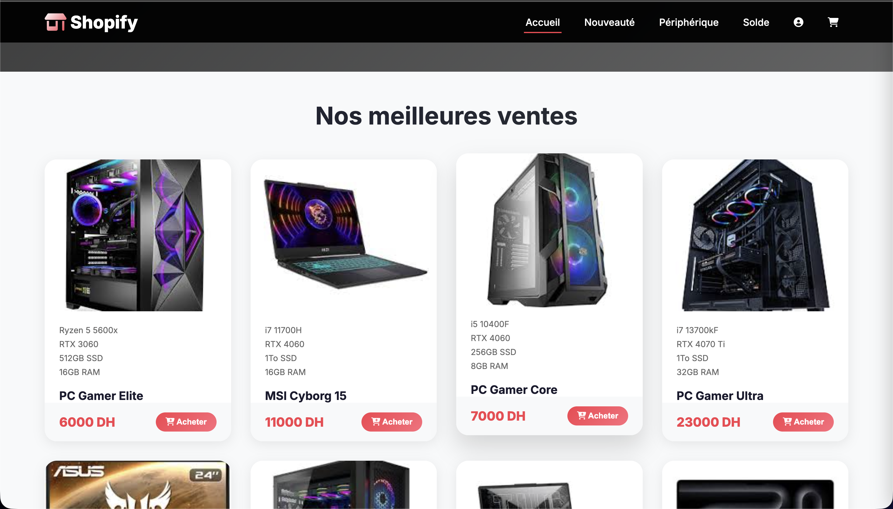
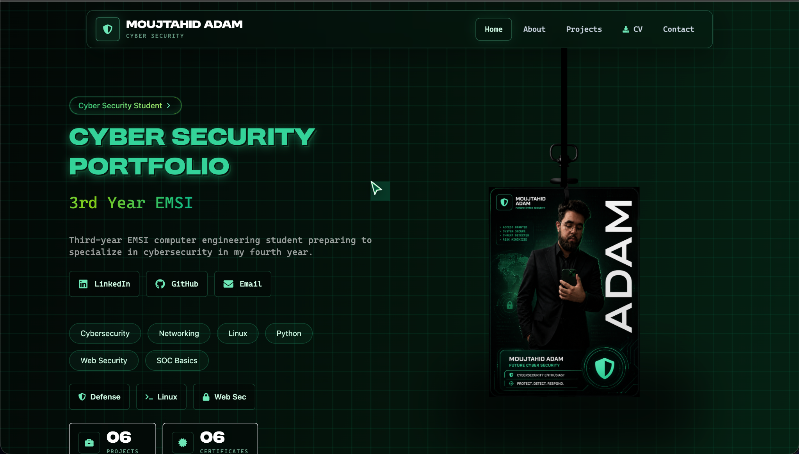
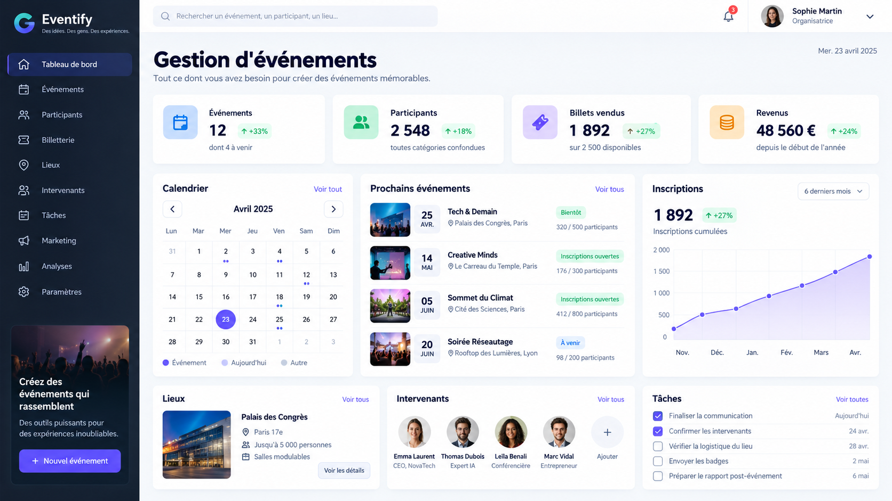
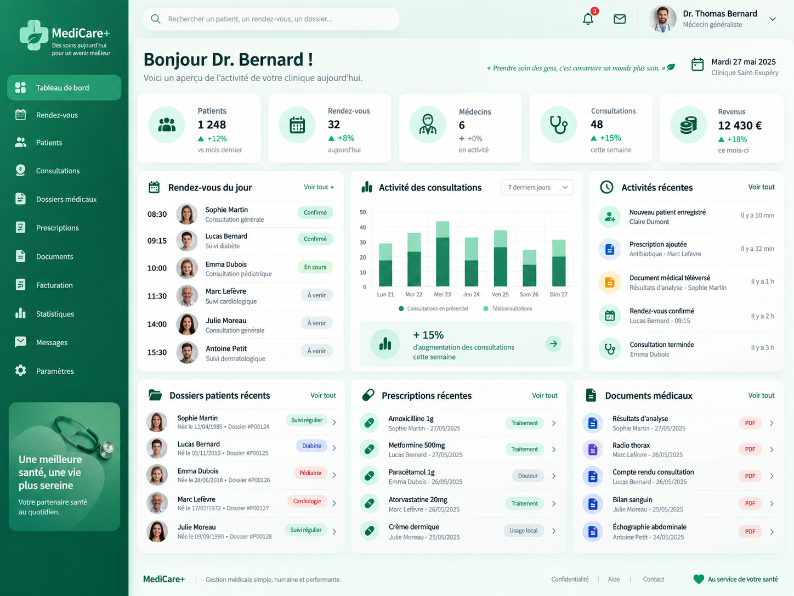
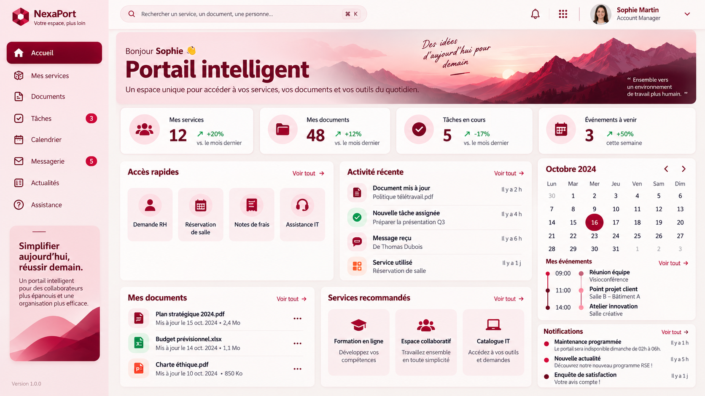

<div align="center">

# ⚡ Adam Moujtahid — Portfolio

### Software Engineering × Data × Artificial Intelligence

<p>
  A modern personal portfolio built to present my projects, technical stack, academic journey,
  and evolution toward software engineering, Big Data and Artificial Intelligence.
</p>

<p>
  
  
  
  
</p>

<p>
  
  
  
  
</p>

**Build. Learn. Improve. Repeat.**

</div>

---

## ✨ About the Portfolio

This repository contains my personal portfolio — a project designed to represent not only what I build, but also the direction of my engineering journey.

I am **Adam Moujtahid**, a Computer Engineering & Networks student at **EMSI**, currently strengthening my expertise in **Software Engineering, Big Data and Artificial Intelligence**.

My approach is simple:

```text
Understand the problem
        ↓
Learn the right technology
        ↓
Build a practical solution
        ↓
Improve the architecture
        ↓
Turn experience into stronger engineering skills
```

The portfolio focuses on modern web development while presenting my interest in data-driven systems, automation and intelligent applications.

---

## 🧭 Engineering Direction

<div align="center">

### DATA-DRIVEN THINKING · INTELLIGENT SYSTEMS · CLEAN ARCHITECTURE
### CONTINUOUS LEARNING · USEFUL AUTOMATION · RESPONSIBLE AI

</div>

My long-term objective is to become a **Software Engineer** capable of building robust and scalable applications while combining strong software engineering foundations with **Data Engineering, Big Data and AI**.

---

## 🚀 Featured Projects

<table>
<tr>
<td width="50%" align="center">

### 🛒 E-commerce



Shopping-oriented project focused on a clear user experience and practical product management.

**Project · 2026**

</td>
<td width="50%" align="center">

### 💼 Portfolio V2



A refined portfolio iteration designed to present projects, skills and professional progress.

**Next.js · React · Tailwind CSS · Framer Motion**

</td>
</tr>
<tr>
<td width="50%" align="center">

### 📅 Management Event



A management platform created to organize event information and streamline related workflows.

**Project · 2026**

</td>
<td width="50%" align="center">

### 🏥 Gestion Santé



A digital health-management project designed around organized information and clearer operational workflows.

**FastAPI · Python · PostgreSQL · React · Tailwind CSS**

</td>
</tr>
</table>

### 🎓 Portail Absence



A portal for managing absence records and making attendance information easier to follow.

**React · Python · PostgreSQL**

---

## 🛠️ Technology Stack

### Frontend

<p>
  
  
  
  
  
  
  
</p>

### Backend

<p>
  
  
  
  
  
</p>

### Databases

<p>
  
  
  
</p>

### Programming & Tools

<p>
  
  
  
  
  
  
  
  
</p>

---

## 🎓 Journey

```text
2023
│
├── Baccalaureate — Physical Sciences
│
├── Joined EMSI
│   └── Computer Engineering & Networks
│
├── Engineering Studies
│   ├── Programming
│   ├── Databases
│   ├── Linux & Systems
│   ├── Networks
│   └── Software Development
│
├── Software Development Internship
│   └── IRMA Services
│
├── Current Specialization
│   └── Big Data & Artificial Intelligence
│
└── Career Goal
    └── Software Engineer — Software × Data × AI
```

---

## 🏗️ Portfolio Architecture

```text
adam-moujtahid-portfolio/
│
├── app/
│   ├── [lang]/
│   ├── globals.css
│   ├── layout.tsx
│   └── page.tsx
│
├── components/
├── contents/
│   ├── en.json
│   ├── tr.json
│   └── shared.json
│
├── dictionaries/
├── hooks/
├── lib/
│
├── public/
│   ├── profile/
│   │   └── adam-moujtahid.jpg
│   ├── projects/
│   ├── stack/
│   └── cv-moujtahid-adam.pdf
│
├── package.json
├── next.config.ts
├── vercel.json
└── README.md
```

The project separates UI components, localized content, shared data and static assets to keep the portfolio easier to maintain and evolve.

---

## ⚙️ Local Development

### Requirements

- Node.js
- npm
- Git

Clone the repository:

```bash
git clone https://github.com/admoujta/adam-moujtahid-portfolio.git
cd adam-moujtahid-portfolio
```

Install dependencies:

```bash
npm ci
```

Start the development server:

```bash
npm run dev
```

### Production checks

```bash
npm run lint
npx tsc --noEmit
npm run build
npm start
```

---

## 🌍 Deployment

The portfolio is configured for **Vercel** deployment using the included `vercel.json` configuration.

```json
{
  "framework": "nextjs",
  "buildCommand": "npm run build",
  "installCommand": "npm ci"
}
```

---

## 📌 What This Portfolio Represents

This portfolio is more than a landing page. It documents my progression as an engineering student and my transition from learning individual technologies to understanding how they work together inside complete systems.

```text
Software Engineering
        +
Data Engineering
        +
Big Data
        +
Artificial Intelligence
        ↓
Useful, scalable and intelligent software
```

---

## 🤝 Connect With Me

<div align="center">

<a href="https://github.com/admoujta">
  
</a>
<a href="https://www.linkedin.com/in/adam-moujtahid-0416b019a">
  
</a>
<a href="mailto:moujtahidadam5@gmail.com">
  
</a>

</div>

---

## 👨‍💻 Author

<div align="center">


### Adam Moujtahid

**Computer Engineering & Networks Student — EMSI**  
**Software Engineering · Big Data · Artificial Intelligence**

📍 Morocco

<br />

> *Turning learning into projects, and projects into engineering experience.*

<br />

⭐ **If you like the project, feel free to star the repository.**

</div>

---

## 📄 License

This portfolio is based on an MIT-licensed portfolio template. The original copyright notice is retained in [`LICENSE`](LICENSE).
